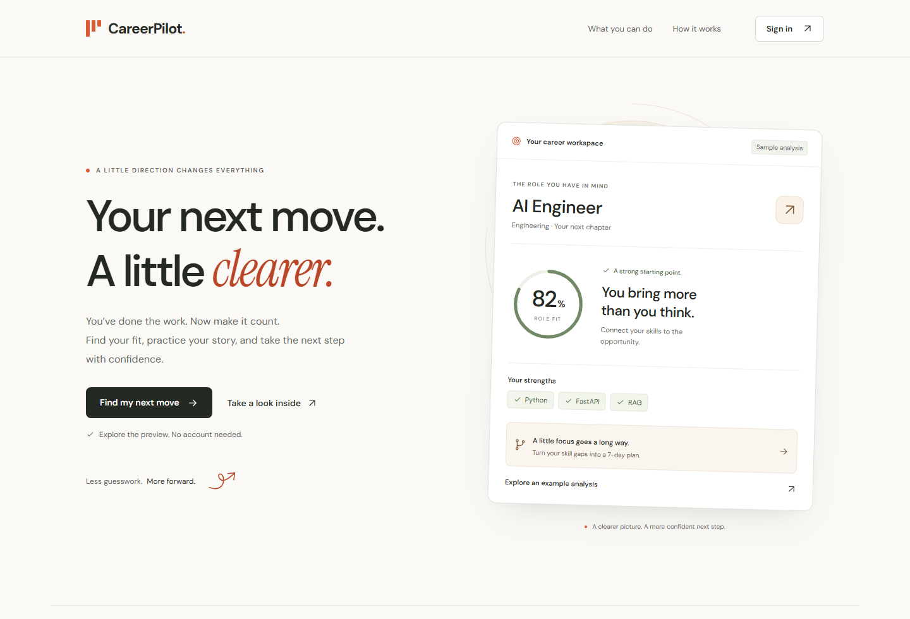

# CareerPilot AI

A career preparation workspace for resume matching, interview practice, and personalized next steps.

**[View Live Demo](https://careerpilot-ai-three-virid.vercel.app)**



## Features

- **Resume analysis** — Compare your experience with a job description and identify skill gaps.
- **Preparation plans** — Get a focused seven-day learning plan.
- **Interview practice** — Answer role-specific questions and review feedback.
- **Career coach** — Ask questions using your resume and target role as context.

## Tech Stack

React · Vite · FastAPI · SQLite · Ollama · LangChain · LangGraph · ChromaDB · BM25

## Project Structure

```text
CareerPilotAI/
├── frontend/             # React interface, Vercel account API, and tests
├── backend/              # API, AI workflows, and backend tests
├── docs/                 # Preview image
├── fine_tuning/          # Optional experiment notes
├── setup_windows.ps1     # Install dependencies
├── run_windows.ps1       # Start local services
└── docker-compose.yml    # Local Docker configuration
```

## Run Locally

Requires **Python 3.12**, **Node.js 22.12+**, and **Ollama**. Keep Ollama running.

```powershell
git clone https://github.com/pallavivhalgade/CareerPilotAI.git
cd CareerPilotAI
powershell -ExecutionPolicy Bypass -File .\setup_windows.ps1
ollama pull llama3.2:3b
powershell -ExecutionPolicy Bypass -File .\run_windows.ps1
```

**App:** http://localhost:5173 · **API docs:** http://localhost:8000/docs

Configuration examples: [backend](backend/.env.example) · [frontend](frontend/.env.example).

## Deployment

The frontend is hosted on **Vercel**. Use `frontend` as the root directory, `npm run build` as the build command, and `dist` as the output directory.

Hosted accounts use Neon Postgres (`DATABASE_URL`) and a server-only `SECRET_KEY`. AI features still require a connected Python backend; preview mode uses sample data.

---

Built by [Pallavi Vhalgade](https://github.com/pallavivhalgade).
